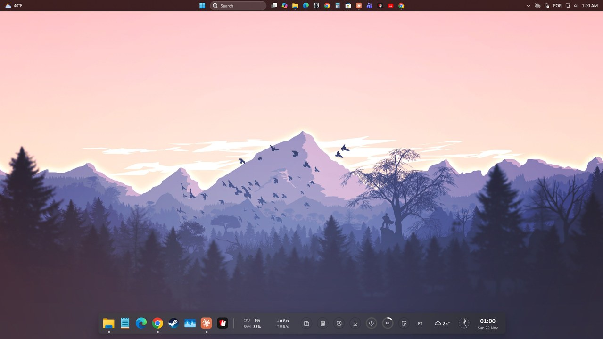
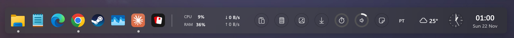

<div align="center">

<picture>
  <source media="(prefers-color-scheme: dark)" srcset="docs/images/logo-dark.svg">
  
</picture>

**A clean, macOS-style floating dock for Windows 11.**
Real glass, smooth magnification, minimalist widgets and 20 languages. Free and private.

<a href="../../releases/latest"><b>⬇ Download the installer</b></a> ·
<a href="../../releases">All versions</a> ·
<a href="#support-the-project">Support the project</a>



</div>

---

## Contents
- [Highlights](#highlights)
- [Widgets](#widgets)
- [Install](#install)
- [Languages](#languages)
- [Privacy and security](#privacy-and-security)
- [Using the dock](#using-the-dock)
- [Build from source](#build-from-source)
- [Documentation](#documentation)
- [Support the project](#support-the-project)
- [License](#license)

## Highlights



- **Real glass.** Windows Desktop Acrylic or Mica, with the same tint and transparency on the dock, tooltips, panels and menus.
- **macOS-style magnification.** Icons grow smoothly under the cursor, and the rest of the dock stays still.
- **Your apps.** You get real high-resolution icons for pinned and running apps, with indicators for open windows and the active app. Packaged (Store) apps work too.
- **Drag and drop everything.** Reorder apps and widgets by dragging. Drop an `.exe` or `.lnk` on the dock to pin it. Every change is saved automatically.
- **Click behavior.** Click to open an app or bring it forward. Click again to cycle through its windows or minimize it. Middle-click opens a new window.
- **Visibility modes.** *Smart* hides the dock for full screen, maximized windows, the browser or File Explorer. *Auto-hide* and *Always visible* are also available.
- **Positions.** The dock can sit at the bottom, top, left or right of the screen.
- **Classic minimalist look.** Widgets are monochrome and match the glass. No colors fight your wallpaper.
- **Lightweight.** It runs alongside the Windows taskbar and doesn't modify the system. It needs no admin rights and is idle at ~0% CPU.

## Widgets

The widgets appear to the right of your apps. Click a widget to open its panel and right-click it for more options. Turn widgets on or off in **Settings**.

| Group | Widgets |
|---|---|
| System | CPU and RAM (ring, line, bars, gauge or text) · Network speed · Volume · Battery · Bluetooth devices with battery · Keyboard language |
| Time | Digital clock with a full calendar (month, week, day and list views; recurring events, reminders, `.ics` import and export) · Analog clock · World clock · Day/week/month/year progress |
| Tools | Clipboard history · Calculator (scientific, date math, number bases, unit and currency converter) · Screenshot · Color picker · Emoji panel · Stopwatch · Timer |
| Productivity | Quick notes (multiple notes, rich text, search) · To-do list · Focus timer (Pomodoro) · Water reminder · Posture reminder |
| Files | Recent downloads · Recent photos · File shelf · Bookmarks · App and file search · Open windows |
| Online (opt-in) | Weather (open-meteo.com) · iCal agenda · Services (GitHub, Stripe, Plausible, Shopify, Linear or any JSON API) |

## Install

1. Download **`CleanWinVista-Setup-1.0.2.exe`** from the [latest release](../../releases/latest).
2. Run it. The installer has the same glass look as the dock and takes four steps: **Language → Options → Install → Finish**.
3. Pick your language (it becomes the app's language), the install folder, the Start menu and desktop shortcuts, and whether the dock starts with Windows.
4. Optionally, tick **Also install CleanPano** to install my free PC cleaner, [CleanPano](https://github.com/CleanPano/CleanPano), afterwards.

**Requirements:** Windows 11 (x64). Nothing else is needed, because the .NET runtime and Windows App SDK are included.

- **Per-user install.** Files go to `%LOCALAPPDATA%\Programs\CleanWinVista`. The installer needs no administrator rights and writes nothing to system folders.
- **Uninstall.** Go to *Windows Settings → Apps → Installed apps → CleanWinVista*. Uninstalling removes only the files the installer added, and you can choose whether to keep your settings and notes.
- **Unsigned installer.** Windows SmartScreen may show "Unknown publisher" because the installer isn't code-signed yet. Check the SHA-256 published with each release.

## Languages

English is the main language. The installer and the app also come in **the 20 most spoken languages**:

English · 简体中文 · हिन्दी · Español · Français · العربية · বাংলা · Português (Brasil) · Русский · اردو · Bahasa Indonesia · Deutsch · 日本語 · Türkçe · Tiếng Việt · 한국어 · Italiano · فارسی · தமிழ் · Polski

Arabic, Urdu and Persian use a right-to-left layout, and dates and numbers follow the language you choose. You can change the language at any time in **Settings → Language**.

> The translations were machine-assisted. If you're a native speaker and spot something odd, please open an issue or a pull request. The translations live in `src/NovaTaskbar.App/i18n/<code>.json`.

## Privacy and security

- **No telemetry, no accounts, no ads.**
- **Internet is off by default.** Only the Weather, Agenda, Currency and Services widgets can go online, and only after you turn on *Allow internet widgets*. They send HTTPS requests directly to the services you set up, and nothing passes through a server of ours.
- **Encrypted keys.** API keys for the Services widget are encrypted on your PC (Windows DPAPI) and never written to logs.
- **Local history.** Clipboard history is kept in memory only, for the current session.
- **Security audit.** The project went through a pre-release security audit. See [docs/SECURITY-AUDIT-1.0.0.md](docs/SECURITY-AUDIT-1.0.0.md).

## Using the dock

- Hover over the dock to magnify it. Click to open an app or bring it forward. Middle-click opens a new window.
- Drag icons and widgets to reorder them. Drop an `.exe` or `.lnk` from File Explorer to pin it.
- Right-click the dock for **Settings…**, **Add app…**, position and more.
- Running `NovaTaskbar.exe` again while the dock is open shows Settings.

Settings are stored in `%LOCALAPPDATA%\NovaTaskbar\settings.json` and logs in `%LOCALAPPDATA%\NovaTaskbar\logs`.

## Build from source

The app is built with C# / .NET 10 and WinUI 3 (Windows App SDK, unpackaged), uses MVVM and is tested with xUnit.

```powershell
scripts\build.ps1 -Run          # build + unit tests + start the dock
scripts\build.ps1 -Integration  # + integration tests on real Windows
```

You can also double-click **`RUN.cmd`**. It builds, tests, publishes the Release folder to `dist\app`, checks for vulnerable packages and writes everything to `docs\last-run.log`.

**Building the single-file installer (NSIS):**

```bash
# put the official CleanPano-Setup.exe in installer/extras/ first (optional component)
makensis -DVERSION=1.0.2 installer/CleanWinVista.nsi   # → dist/CleanWinVista-Setup-1.0.2.exe
```

## Documentation

[Changelog](docs/CHANGELOG.md) · [Known issues](docs/KNOWN-ISSUES.md) · [Architecture](docs/ARCHITECTURE.md) ·
[Windows integration](docs/WINDOWS-INTEGRATION.md) · [Testing](docs/TESTING.md) · [Roadmap](docs/ROADMAP.md) ·
[Security audit](docs/SECURITY-AUDIT-1.0.0.md)

## Support the project

CleanWinVista is free. If it makes your desktop nicer, a donation helps keep development going. Thank you! 💛

| Coin | Network | Address |
|---|---|---|
| **Bitcoin (BTC)** | Bitcoin (Native SegWit) | `bc1qnkpm79xsymwn0w6gyq7hthrhd247r9pcysqs2w` |
| **Ethereum (ETH)** | Ethereum / ERC-20 | `0xaaee7cd8a131bca4372ef14823a9dfe12f2108e3` |

Send each coin only to its own address and network. Both addresses are also in the app under **Settings → Support the project**.

You might also like **[CleanPano](https://github.com/CleanPano/CleanPano)**, a free PC cleaner and optimizer by the same developer.

## License

CleanWinVista is open source under the [MIT License](LICENSE). It uses the Windows App SDK, CommunityToolkit.Mvvm and Microsoft.Extensions, all MIT-licensed. The optional CleanPano installer is a separate program with its own license.
