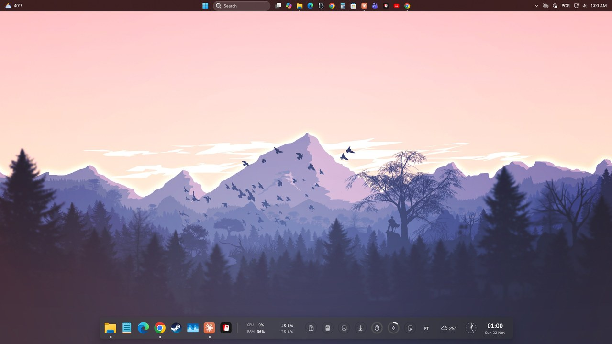

# CleanWinVista 1.0.0 — first public release

A clean, macOS-style floating dock for Windows 11: real glass, smooth magnification, minimalist widgets and 20 languages.

## Download

**[CleanWinVista-Setup-1.0.0.exe](../../releases/download/v1.0.0/CleanWinVista-Setup-1.0.0.exe)** — 65 MB, Windows 11 x64. Per-user install, no administrator rights needed.

SHA-256: `05b140a848323a8638947ccafd1c5960a7f73e3552bd23d6cfd0f1d865658f65`

> The installer isn't code-signed yet, so Windows SmartScreen may say "Unknown publisher". Compare the SHA-256 above before running it (`Get-FileHash .\CleanWinVista-Setup-1.0.0.exe`).

## What's inside

- **Dock.** Real Desktop Acrylic or Mica glass and macOS-style magnification that doesn't move the rest of the dock. You can pin apps, see running apps with indicators, drag and drop everything, and changes save automatically.
- **Widgets.** CPU/RAM, network, volume, battery, Bluetooth devices, a clock with a full calendar, a calculator (scientific, dates, number bases, units and currency), multi-note quick notes, clipboard history, downloads, photos, focus timer, weather and more. All monochrome, matching the glass.
- **Panels and menus.** These use the same glass, corners and border as the dock, and open above it without covering it.
- **20 languages.** English is the main language. The other 19: 简体中文, हिन्दी, Español, Français, العربية, বাংলা, Português (Brasil), Русский, اردو, Bahasa Indonesia, Deutsch, 日本語, Türkçe, Tiếng Việt, 한국어, Italiano, فارسی, தமிழ், Polski. Arabic, Urdu and Persian use a right-to-left layout.
- **Installer.** It has the dock's glass look and four steps: Language → Options → Install → Finish. You choose the language, folder, Start menu and desktop shortcuts, and whether the dock starts with Windows. There's also an optional **"Also install CleanPano"** checkbox, which opens the official CleanPano installer.
- **Clean uninstall.** Go to *Settings → Apps → Installed apps*. Uninstalling removes only the files the installer added.

## Privacy and security

- No telemetry, accounts or ads.
- Internet widgets are **off by default** and connect over HTTPS only.
- Service API keys are encrypted on your PC with DPAPI.
- A pre-release security audit was done, and every finding except code signing was fixed: [SECURITY-AUDIT-1.0.0.md](SECURITY-AUDIT-1.0.0.md).
- No known vulnerable NuGet packages (`dotnet list package --vulnerable`).

## Known limitations

- Translations were machine-assisted. Native-speaker fixes are welcome (`src/NovaTaskbar.App/i18n/`).
- In vertical positions (left or right), widgets are hidden.
- Only the primary monitor is supported.
- See [KNOWN-ISSUES.md](KNOWN-ISSUES.md) for the full list.

## Support

CleanWinVista is free. Donations: **BTC** `bc1qnkpm79xsymwn0w6gyq7hthrhd247r9pcysqs2w` · **ETH** `0xaaee7cd8a131bca4372ef14823a9dfe12f2108e3`
