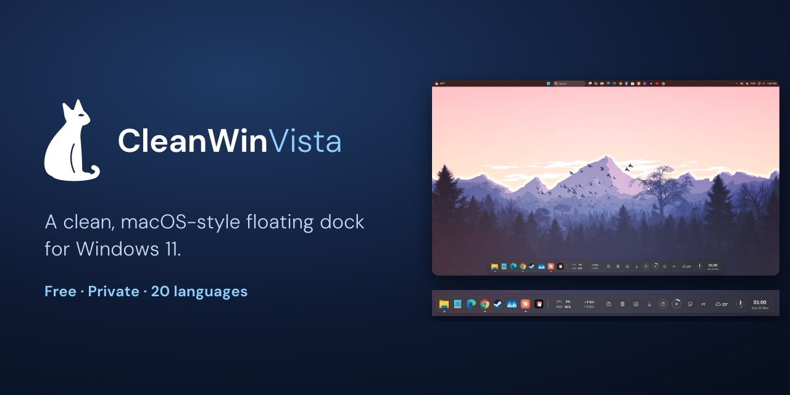

# CleanWinVista 1.0.1 — new look

A clean, macOS-style floating dock for Windows 11. This release brings the new CleanWinVista identity.

## Download

**[CleanWinVista-Setup-1.0.1.exe](../../releases/download/v1.0.1/CleanWinVista-Setup-1.0.1.exe)** — 65 MB, Windows 11 x64. Per-user install, no administrator rights needed.

SHA-256: `790eebe6537f62ee8fa3894125fb1b6b032a59021a072ea33cbad0fbf9ecfdbf`

> The installer isn't code-signed yet, so Windows SmartScreen may say "Unknown publisher". Compare the SHA-256 above before running it (`Get-FileHash .\CleanWinVista-Setup-1.0.1.exe`).

## What's new

- **New logo.** A sitting cat in profile, drawn as a clean silhouette.
- **New app icon.** A white cat on a blue tile, used for the app, its windows, the taskbar and the installer. Small sizes (16–24 px) use a simplified version so it stays sharp.
- **README** now shows the logo, with light and dark theme versions.

No functional changes since 1.0.0. All 217 unit tests pass. To update, just run the new installer.

## Support

CleanWinVista is free. Donations: **BTC** `bc1qnkpm79xsymwn0w6gyq7hthrhd247r9pcysqs2w` · **ETH** `0xaaee7cd8a131bca4372ef14823a9dfe12f2108e3`
