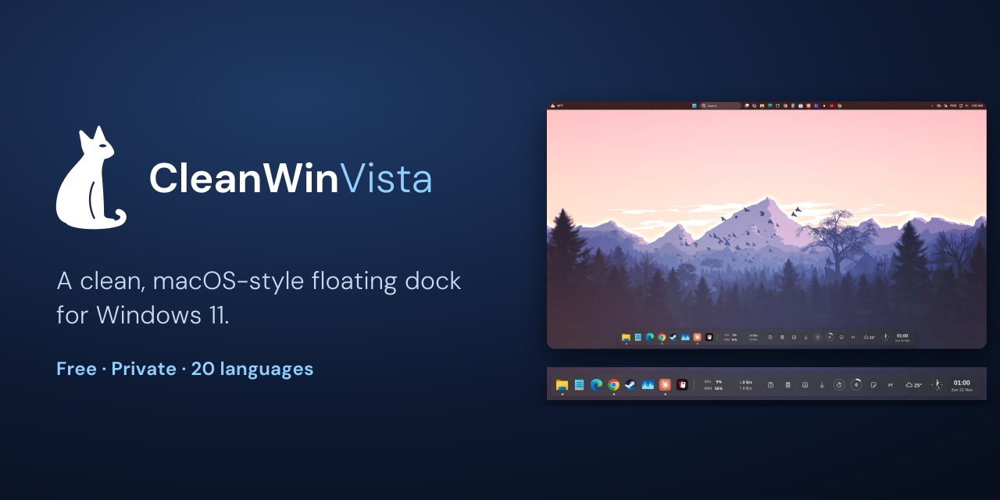

# CleanWinVista 1.0.2 — installer fixed

A clean, macOS-style floating dock for Windows 11. This release fixes the installer and makes auto-hide behave in full-screen apps.

## Download

**[CleanWinVista-Setup-1.0.2.exe](../../releases/download/v1.0.2/CleanWinVista-Setup-1.0.2.exe)** — 65 MB, Windows 11 x64. Per-user install, no administrator rights needed.

SHA-256: `0a16a94fbbd0f493692cb16d4a66399bc37a8c0d1276b4074428737c7e692606`

> The installer isn't code-signed yet, so Windows SmartScreen may say "Unknown publisher". Compare the SHA-256 above before running it (`Get-FileHash .\CleanWinVista-Setup-1.0.2.exe`).

## What's fixed

- **Installer closed when you clicked Install/Update.** The progress page crashed the setup window. It now uses its own progress bar in the dock's style.
- **The installed app didn't open.** A required resource file (`NovaTaskbar.pri`) was missing from the package, so 1.0.0 and 1.0.1 installs failed to show the dock. It's now included, and the build checks for it.
- **Auto-hide in full-screen apps.** With a video, game or F11 browser in full screen, moving or scrolling the mouse at the bottom of the screen no longer pops the hidden dock back up.
- **Setup window** is readable on Windows light theme (the content card was white with white text).
- If an install ever fails, the setup now shows the error and writes a log to `%TEMP%\CleanWinVista-setup.log`.

Tested end to end on Windows 11: run the installer → Update → Finish → the installed dock opens. To update, just run the new installer; your settings are kept.

## Support

CleanWinVista is free. Donations: **BTC** `bc1qnkpm79xsymwn0w6gyq7hthrhd247r9pcysqs2w` · **ETH** `0xaaee7cd8a131bca4372ef14823a9dfe12f2108e3`
