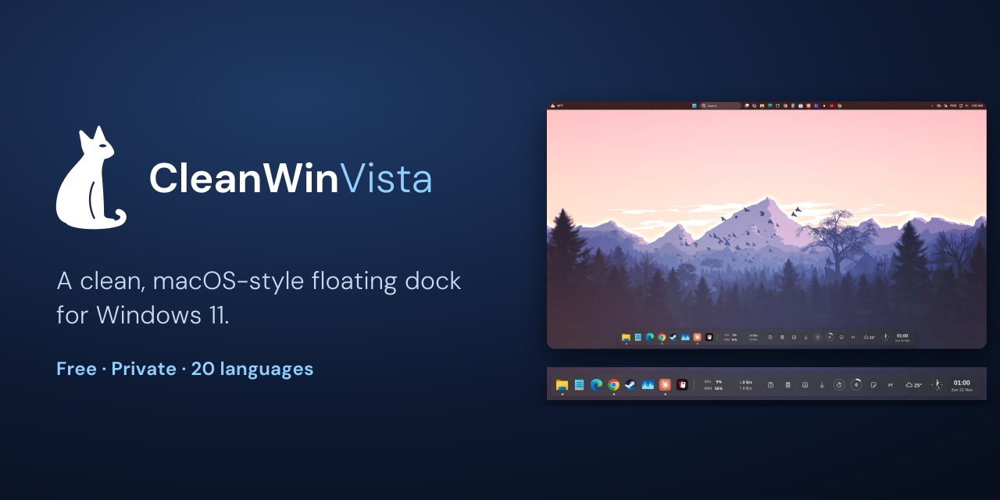

# CleanWinVista 1.0.3 — power button and fixes

A clean, macOS-style floating dock for Windows 11. This release adds a power button, so the dock can stand in for the Windows taskbar, and fixes several rough edges.

## Download

**[CleanWinVista-Setup-1.0.3.exe](../../releases/download/v1.0.3/CleanWinVista-Setup-1.0.3.exe)** — 65 MB, Windows 11 x64. Per-user install, no administrator rights needed.

SHA-256: `394cf17ee4bfcb1946114ca29b9253191006dad8ab4d8b8b1dc30281b4ecb17c`

> The installer isn't code-signed yet, so Windows SmartScreen may say "Unknown publisher". Compare the SHA-256 above before running it (`Get-FileHash .\CleanWinVista-Setup-1.0.3.exe`).

## What's new

- **Power button.** A new widget at the end of the dock: Lock, Sleep, Sign out, Restart and Shut down. Sign out, Restart and Shut down ask for confirmation in the panel. Nothing is forced: Windows still warns about unsaved work. On by default; turn it off in Settings → Widgets.

## What's fixed

- **Calculator flickered on every key click.** The keypad buttons no longer take focus away from the number box. Same fix for the Notes formatting buttons and the base converter.
- **Keyboard language sometimes didn't switch.** The request now goes to the window that actually has keyboard focus, and the dock checks a moment later; if the app ignored it, it falls back to the Windows shortcut (Win + Space).
- **Analog clock is decorative.** Clicking it no longer does anything.
- **Auto-hide.** When the dock is brought up over a full-screen or maximized app, a browser or File Explorer, clicking outside the dock hides it right away.

All 218 unit tests pass. To update, just run the new installer; your settings are kept.

## Support

CleanWinVista is free. Donations: **BTC** `bc1qnkpm79xsymwn0w6gyq7hthrhd247r9pcysqs2w` · **ETH** `0xaaee7cd8a131bca4372ef14823a9dfe12f2108e3`
